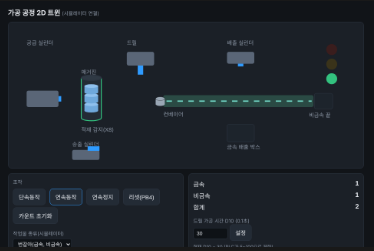

# 스마트 팩토리 가공 공정 2D 디지털 트윈

부산인력개발원 AI스마트제조융합 과정(6개월)에서 배운 PLC, HMI, 웹(Flask), 데이터 처리를 하나로 묶어 만든
**가공 공정 시뮬레이션과 2D 디지털 트윈** 포트폴리오 프로젝트입니다.



## 무엇을 하는가
실습 장비(미쓰비시 Q02H PLC, Pro-face HMI)에서 만든 **가공 공정 PLC 프로그램**을
GX Works2에서 내보낸 명령어 목록(CSV)으로 읽어 Python으로 스캔 단위 실행하고,
그 상태를 웹 화면(2D 트윈)에 실시간으로 보여 줍니다.

공정 순서: 공급 실린더 → 드릴 가공 → 송출 실린더 → 컨베이어 → 금속/비금속 분류 → 배출

## 구성
| 파일 | 역할 |
| --- | --- |
| `plc/1102/*.csv` | 11/2 HMI연동 프로젝트의 프로그램 4개(MAIN, TEST1, READY, HMI) 명령어 목록 |
| `src/plc_sim.py` | CSV 명령어(LD, AND, OUT, MOV, 타이머, PSCAN, POFF 등)를 실행하는 PLC 시뮬레이터와 센서 모델 |
| `src/workpiece.py` | 실린더, 센서, 컨베이어 신호로 작업물 위치를 추정하는 추적기 |
| `src/server.py` | 시뮬레이터를 돌리고 상태를 JSON으로 내보내는 Flask 서버 |
| `src/static/index.html` | 2D 트윈 화면(SVG): 실린더, 드릴, 컨베이어, 램프, 카운터, 조작 버튼 |

## 실행
```
python -m venv .venv
.\.venv\Scripts\Activate.ps1
pip install flask pymodbus
python src/server.py plc/1102
```
브라우저에서 http://localhost:5001 을 엽니다.

- 단속동작, 연속동작, 연속정지, 리셋, 카운트 초기화는 실제 HMI 버튼(M100~M103, PB4)과 같은 입력입니다.
- 드릴 가공 시간(D10)을 바꾸면 PLC 프로그램의 제한 로직(0.5~10초)이 그대로 적용됩니다.
- 작업물 종류(금속, 비금속, 번갈아)를 선택해 분류 경로를 확인할 수 있습니다.

## 실제 장비 기준 확인한 것
- HMI 화면 부품의 디바이스: M100~M103(버튼), Y27~Y2B(표시, 램프), D0/D2/D4(카운터), D10(가공 시간)
- 입출력 맵: X0~X0E(센서, 버튼), Y20~Y2B(솔레노이드, 모터, 램프)

## 한계와 가정
- 실린더 동작 시간과 센서는 단순한 지연 모델이며 실제 장비와 다릅니다.
- 금속 감지는 송출 전진이 끝나는 시점에 시뮬레이터가 정한 값으로 대체했습니다.
- `POFF`가 대기 프로그램의 출력을 끈다고 가정했습니다(실제 PLC에서 추가 확인 필요).
- 작업물 위치는 PLC 값이 아니라 신호 변화로 추정한 값입니다.

## 로드맵
1. 11/3 최종 PLC 로직 반영
2. OpenPLC로 이식하고 Modbus TCP로 태그 읽기(파이썬 게이트웨이)
3. 기존 SMART LINE MES(Flask, SQLite) 및 AI 모듈(품질, PPE, 설비보전)과 연동
4. 안전 정지 로직은 PLC에서 판단하고 AI는 입력 신호만 제공
