# 공정 디지털 트윈 · 스마트 팩토리 (smart-factory-twin)

> 자동차 부품 공장 한 곳을 **시뮬레이션하고, 3D로 보여 주고, MES에 실시간으로 연결**한 프로젝트입니다.
> 가공(PLC) → 프레스 · 용접 · 도장 → 협동로봇 검사 · 적재 → 물류 · 출하까지 한 흐름으로 이어지고,
> 설비에서 나온 이벤트가 작업지시, LOT, 시리얼, 검사, 출하 기록으로 MES에 쌓입니다.

부산인력개발원 **AI 스마트 제조융합 과정**(6개월, 2026.06~11)에서 배운 PLC, HMI, 웹(Flask), 데이터 처리, AI를 하나로 묶은 포트폴리오입니다.
희망 직무는 **생산기술**이라서, 화면을 예쁘게 만드는 것보다 *실제 설비 기준으로 맞는지*와 *숫자로 검증되는지*를 먼저 따랐습니다.

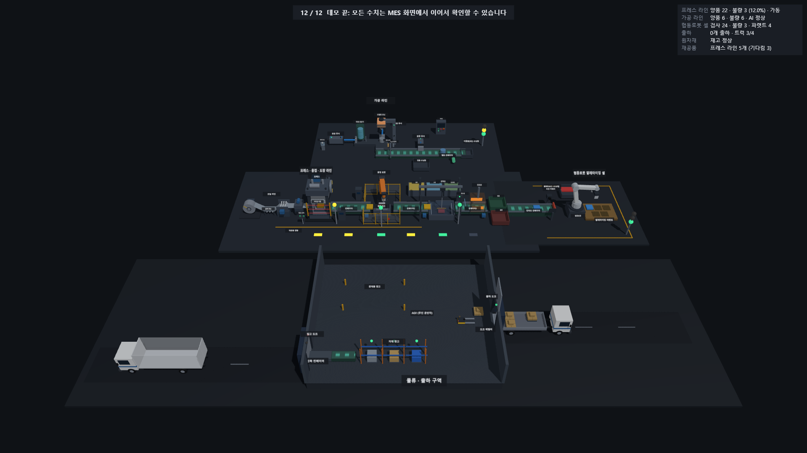

<!-- 시연 영상: 업로드 후 여기에 링크를 넣습니다. 예) [▶ 시연 영상 (약 90초)](https://...) -->

## 한눈에 보기

| 구역 | 무엇을 하는가 | 근거 / 구현 |
|---|---|---|
| **가공 라인 (PLC)** | 공급 실린더 → 드릴 가공 → 송출 → 컨베이어 → 금속/비금속 분류 | 실습 장비(미쓰비시 Q02H, Pro-face HMI)의 PLC 프로그램을 그대로 실행. 래더(CSV)를 읽는 시뮬레이터와 OpenPLC(Modbus TCP) 두 모드 |
| **프레스 · 용접 · 도장 라인** | 코일 급송 → 프레스 성형 → 스폿 용접(6축 로봇) → 전착 도장 → 건조 | 스트레이트 사이드 프레스, 3-2-1 지그, C형 서보 건, 전착조 사양을 조사해서 반영 (`docs/press_3d_reference.md`) |
| **협동로봇 팔레타이징 셀** | 비전 검사 → 양품은 파렛트에 5개씩, 불량은 NG 상자 | 4관절 로봇팔을 **역기구학**으로 구동, 15개 지점 도달을 시험으로 확인 |
| **물류 · 출하 구역** | 만재 트럭 입고 · 하역 → 재고 → 완제품 창고 → AGV → 출하 도크 → 트럭(파렛트 4개가 차야 출발) | 5톤 탑차 · 카고, 도크 레벨러, 신축 컨베이어, T-11 파렛트 규격 (`docs/logistics_3d_reference.md`) |
| **MES 연동** | 설비 이벤트 → 작업지시, 공정 실행, LOT, 시리얼, 검사, 출하 | 기존 Auto Parts MES(Streamlit + SQLite)를 **수정하지 않고** 서비스 함수를 호출 |
| **AI 이상 감지** | 사이클 시간으로 설비 이상 판정 | MAD + EWMA 기반. AI는 판정과 경보만 내고, 정지 여부는 PLC가 판단 |

## 구조

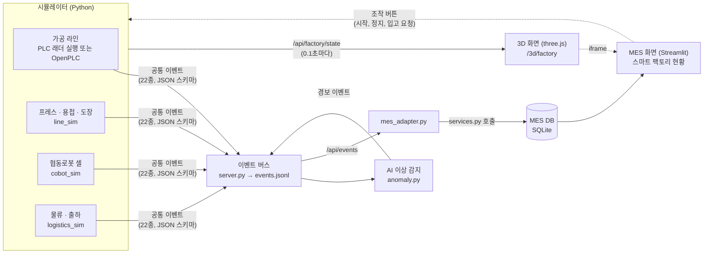

- **시뮬레이터와 화면은 JSON 상태로만 연결**됩니다. 3D 장면(`src/scenes/*.json`)은 상태 값의 경로(`stations.weld.robot.yaw` 같은)에 움직임을 묶어 두어서, 시뮬레이터가 바뀌어도 화면 코드를 고치지 않습니다 (`docs/scene_format.md`).
- **MES로 가는 길은 이벤트 하나**입니다. 설비마다 같은 형식(`docs/event_schema.json`)으로 내보내므로, 새 설비를 붙여도 MES 쪽 규칙만 추가하면 됩니다 (`docs/mes_integration.md`).

## 화면

| | |
|---|---|
| 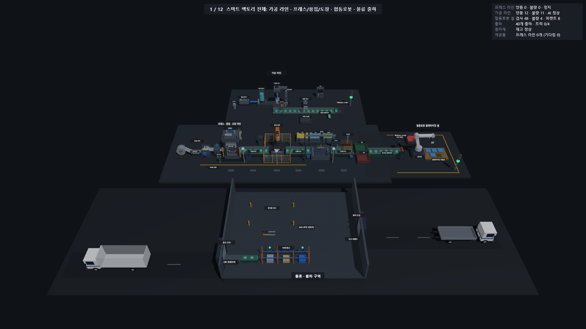 **전체**: 가공, 프레스 · 용접 · 도장, 협동로봇, 물류 구역 | 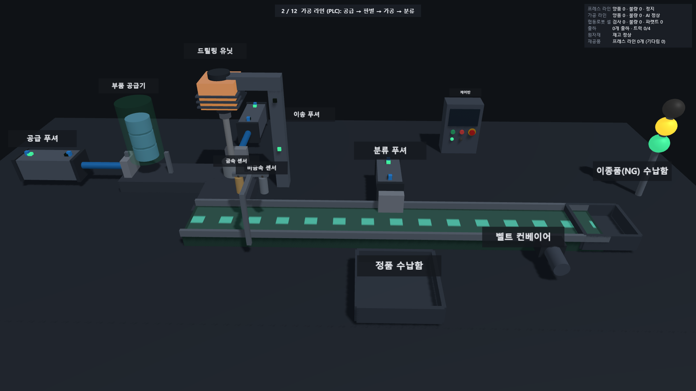 **가공 라인(PLC)**: 실린더 위치 LED, 금속 · 비금속 센서, 제어반 |
| 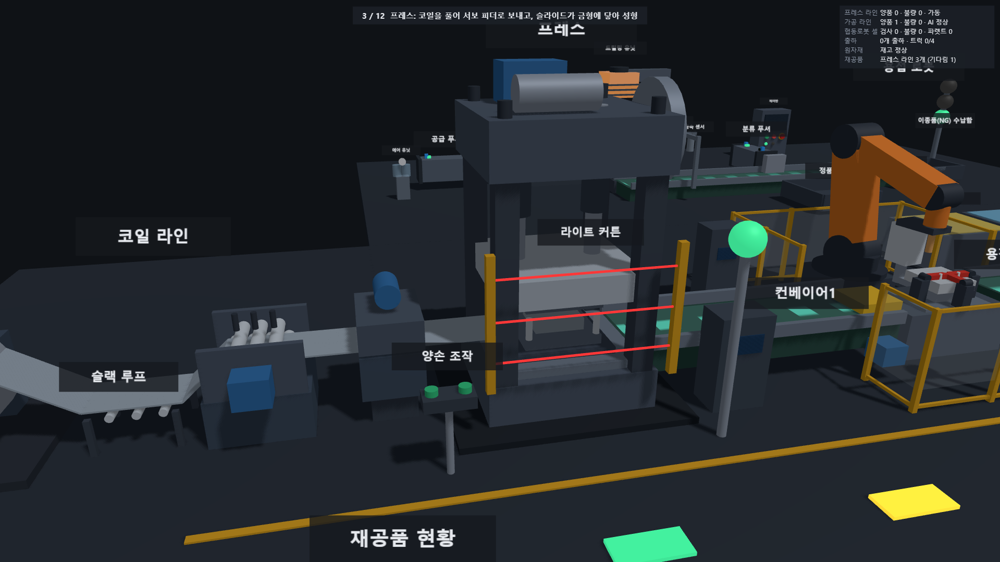 **프레스**: 코일 라인, 서보 피더, 슬라이드가 금형에 닿음 | 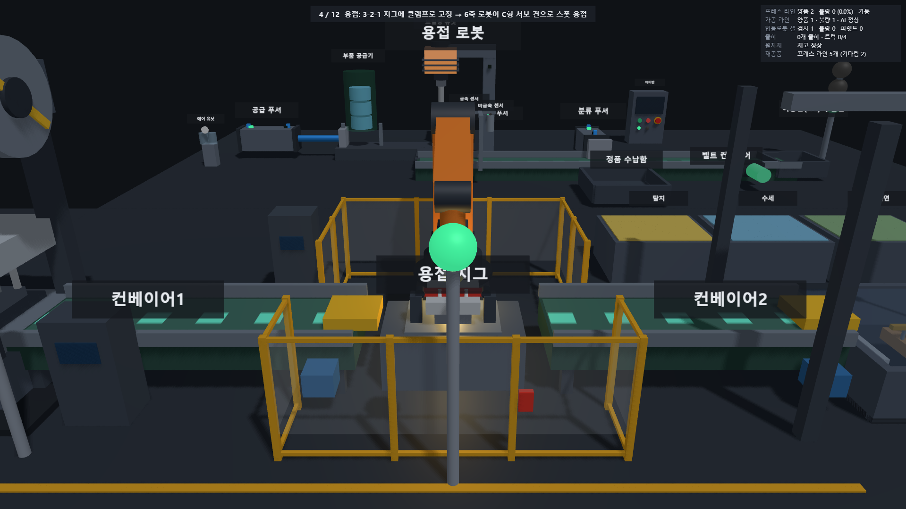 **용접**: 3-2-1 지그, 클램프, 6축 로봇의 C형 건 |
| 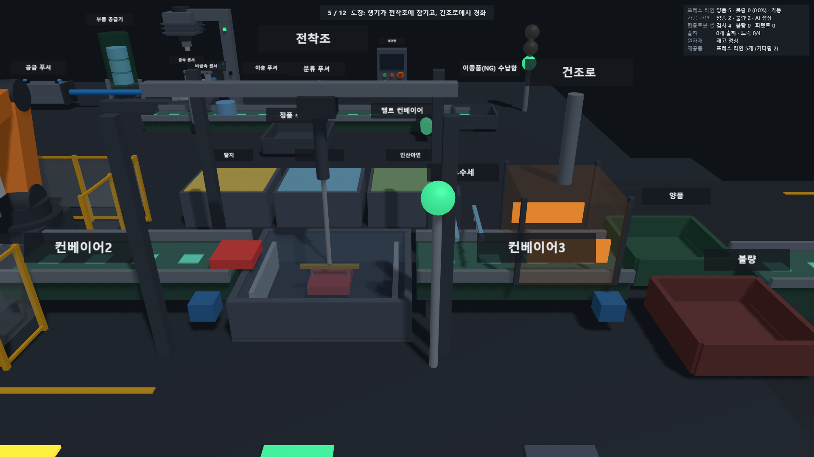 **도장**: 행거가 전착조에 잠김, 건조로 | 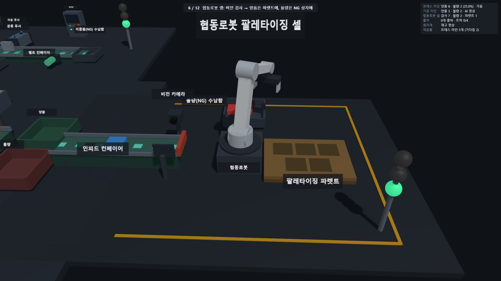 **협동로봇 셀**: 비전 검사, 파렛트 적재 |
| 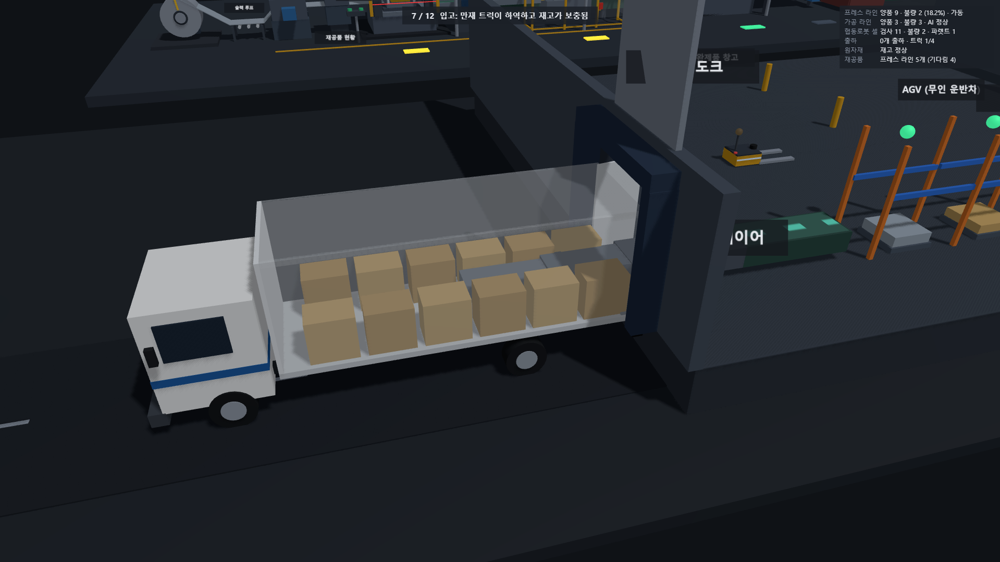 **입고**: 만재 트럭이 신축 컨베이어로 하역 | 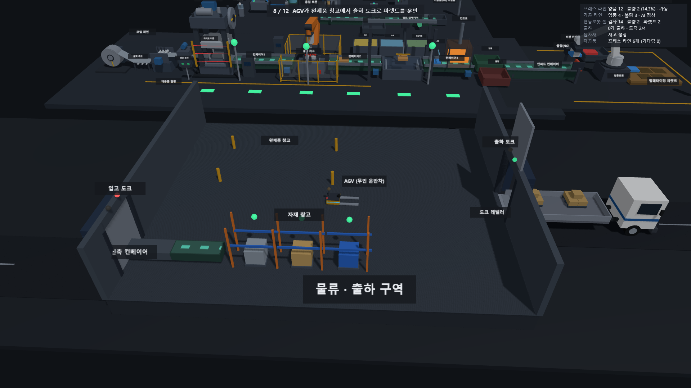 **AGV**: 완제품 창고에서 출하 도크로 파렛트 운반 |
| 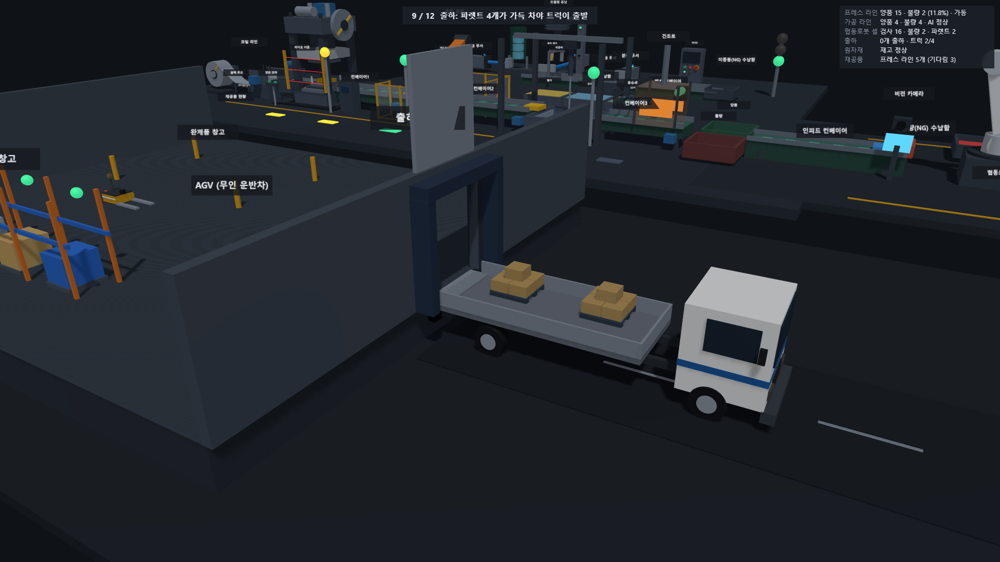 **출하**: 파렛트 4개가 차야 트럭 출발 | 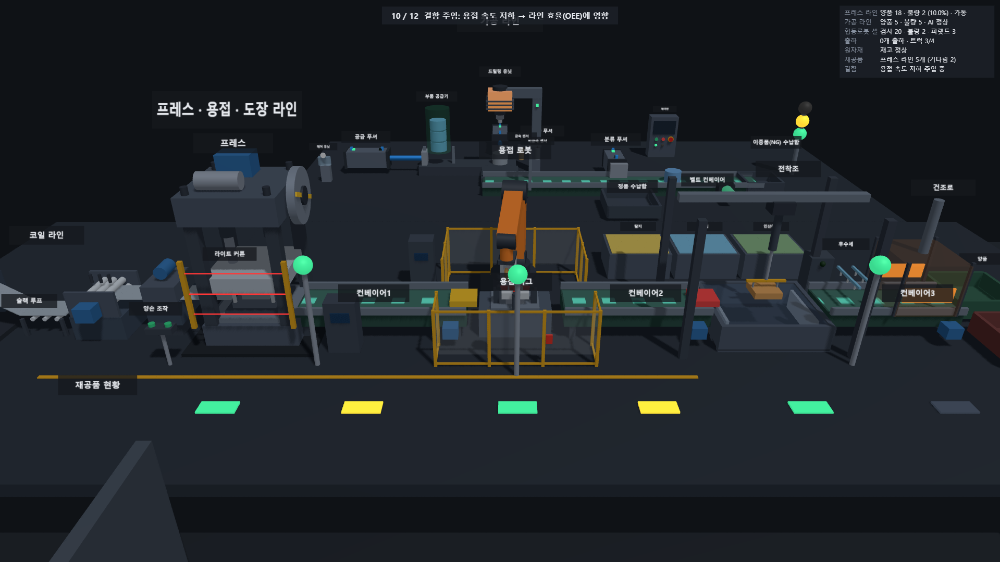 **결함 주입**: 용접 속도 저하로 재공품(노랑)이 쌓임 |
| 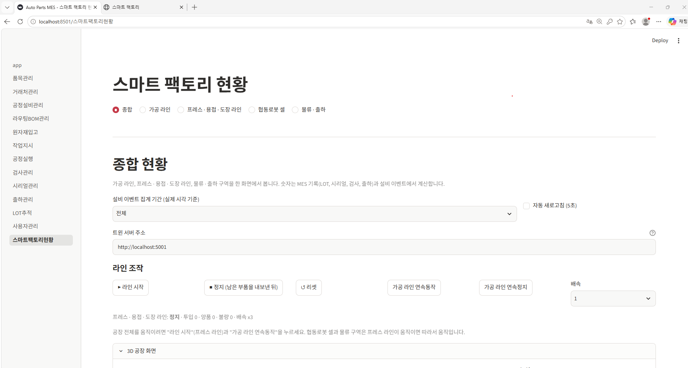 **MES 스마트 팩토리 현황**: 하위 화면 5개 | 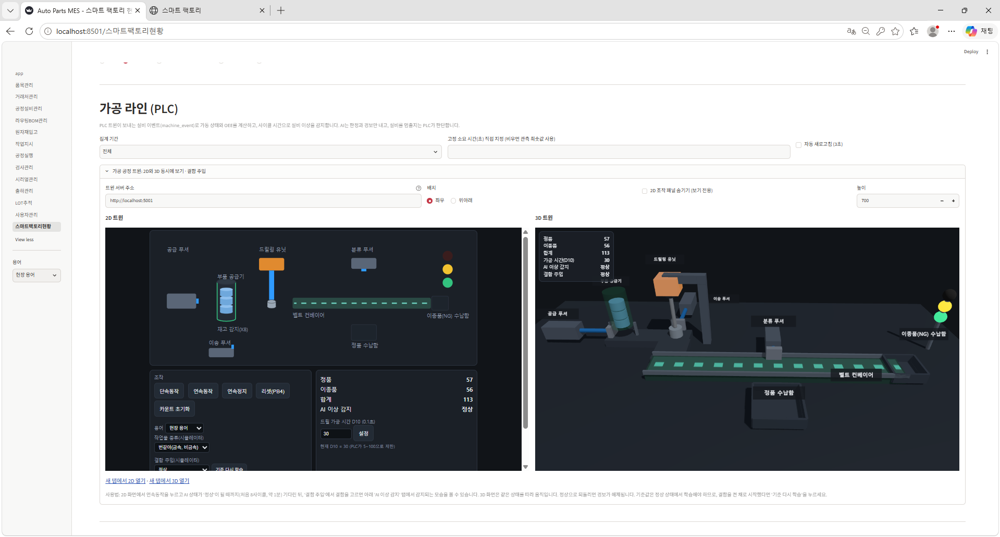 **MES 가공 라인**: 2D와 3D 동시 표시 |

3D 화면 오른쪽 위의 **수치 박스**에 양품 · 불량, 출하, 재고, 재공품이 모이고, **📷 캡처** 버튼으로 수치가 들어간 사진을 저장합니다.
**▶ 데모** 버튼(또는 주소 뒤에 `?demo=1`)을 누르면 카메라가 구역을 돌면서 약 90초 동안 시연이 자동으로 진행됩니다 (`docs/factory.md`).

## 실행

필요: Python 3 (Windows에서 시험), 같은 PC에서 트윈 서버와 MES를 실행. Node.js는 시험에서만 씁니다.

```
python -m venv .venv
.\.venv\Scripts\Activate.ps1
pip install -r requirements.txt
python tools\fetch_three.py          # (선택) 3D 라이브러리를 내려받아 인터넷 없이도 열리게 함
```

**터미널 A: 트윈 서버** (시뮬레이터 4개가 함께 돕니다)
```
python src\server.py plc\1102
```
- 3D 공장: http://localhost:5001/3d/factory  (▶ 데모, 📷 캡처)
- 가공 라인 2D: http://localhost:5001  /  3D: http://localhost:5001/3d

**터미널 B: MES 어댑터** (이벤트를 MES에 쌓음)
```
python src\mes_adapter.py --init-only          # 처음 한 번: DB와 기준정보 준비
python src\mes_adapter.py --install-addons     # 처음 한 번 또는 화면 코드를 고쳤을 때
python src\mes_adapter.py --batch 5
```

**터미널 C: MES 화면**
```
cd ..\AutoParts-MES-Arduino
python seed_admin.py                           # 최초 관리자 계정
streamlit run app.py                           # http://localhost:8501 → 스마트 팩토리 현황
```

시연 전에 쌓인 시험 데이터를 비우려면 `python src\mes_adapter.py --reset-demo`를 씁니다.
MES를 다른 PC에서 열 때는 화면의 "트윈 서버 주소"에 서버가 있는 PC의 주소를 넣습니다.
PLC를 OpenPLC로 돌리는 방법은 `docs/openplc.md`에 있습니다.

## 검증

화면을 눈으로 확인하기 전에, **숫자로 확인할 수 있는 것은 모두 시험으로 만들었습니다.**

```
python tests\run_all.py        # 전체 (시험 파일 22개)
python tests\run_all.py cobot  # 이름에 cobot 이 들어간 것만
```

| 무엇을 | 어떻게 |
|---|---|
| 협동로봇 역기구학 | 15개 지점에 그리퍼 끝이 닿는지, 시뮬레이션 중 집고 놓는 순간의 위치 오차 (`test_cobot.py`) |
| 3D 장면 기하 | 용접 건과 지그의 충돌 2,001개 자세 샘플, 프레스 슬라이드와 금형 접촉 높이, 행거와 전착조 액면, 트럭 뒤끝과 도크 범퍼 간격, 센서와 푸셔 이동 범위 겹침 (`test_press_scene.py`, `test_logistics.py`, `test_machining_scene.py`) |
| 3D 뷰어 동작 | three.js 대역(가짜 라이브러리)에 장면을 올려, 상태값에 따라 부품이 움직이고 보이고 색이 바뀌는지 (`test_factory.py`, `test_linescene.py`) |
| 시뮬레이터 → MES | 화면에 나온 숫자를 이벤트에서 따로 센 값, MES 데이터에서 따로 계산한 값과 비교 (`test_mes_*.py`, `test_cobot_flow.py`) |
| OEE 계산식 | 손으로 계산한 값과 비교 (`test_oee.py`) |
| AI 이상 감지 | 실제 측정한 정상 사이클 데이터로 오탐 확인, 결함 주입 시 감지 지연 (`test_anomaly.py`) |

3D 화면은 제가 직접 눈으로 볼 수 없는 환경에서 만든 부분이 많았습니다. 그래서 좌표와 연결이 맞는지 계산으로 먼저 잡았고,
화면 캡처를 받아 어긋난 곳(이름표 겹침, 틀린 높이)을 고치는 순서로 반복했습니다.

## 설계에서 신경 쓴 점

- **MES를 고치지 않고 붙임**: 어댑터가 MES의 검증 규칙(공정 순서, LOT당 검사 1회)을 그대로 통과하도록, 작업물 N개를 작업지시 1건으로 묶었습니다. 검사 FAIL LOT는 MES가 출하를 자동으로 막습니다.
- **AI와 안전의 분리**: AI는 판정과 경보만 내고, 설비를 멈출지는 PLC가 판단합니다 (`docs/ai_anomaly.md`).
- **실제 설비 기준**: 형상과 수치(프레스 정지시간과 안전거리, 스폿 용접 로봇 가반하중과 도달거리, 전착조 온도와 고형분, 트럭 적재함 높이)를 자료에서 찾아 근거와 한계를 문서로 남겼습니다.
- **병목이 드러나는 모델**: 프레스 4초, 용접 6초, 도장 8초라서 병목은 도장(7.5개/분)입니다. 용접에 결함을 주입하면 앞 공정이 막혀 재공품이 쌓이는 모습이 노란 표시로 보입니다.
- **물류의 현실 규칙**: 입고 트럭은 짐을 가득 싣고 와서 하역하는 만큼 비워지고, 출하 트럭은 파렛트 4개가 차야 출발합니다.

## 한계와 가정

- 설비 동작 시간, 센서, 비전 판정은 단순한 지연과 확률 모델이며 실제 장비와 다릅니다.
- 금속 감지, 작업물 위치 같은 일부 값은 PLC가 아니라 시뮬레이터나 신호 변화로 추정한 값입니다.
- MES 연동은 **단방향**(트윈 → MES)입니다. MES에서 작업지시를 내려 트윈을 제어하는 방향은 다음 단계입니다.
- SQLite는 파일 기반이라 트윈과 MES가 같은 PC에서 돌아야 합니다. 확장 시 PostgreSQL 전환이 필요합니다.
- 3D 모델은 상자와 원기둥으로 만든 단순화 형상입니다. 치수와 배치는 근거 자료를 따르지만 CAD 수준은 아닙니다.
- 출하 트럭은 4개가 차야 출발하므로, 라인이 일찍 멈추면 모자란 파렛트가 도크에 남습니다.
- 원본 래더와 OpenPLC용 ST 코드의 모든 조건 일치는 검증하지 않았습니다 (`docs/openplc.md`).

## 폴더 구조

```
smart-factory-twin/
├─ src/
│  ├─ server.py                 Flask 서버 (API, 3D 화면, 시뮬레이터 구동)
│  ├─ plc_sim.py, modbus_plc.py 가공 라인: 래더 실행 / OpenPLC 연결
│  ├─ line_sim.py, weld_cell.py, paint_cell.py   프레스 · 용접 · 도장 라인과 용접 로봇, 전착조 동작
│  ├─ cobot_sim.py, logistics_sim.py             협동로봇 셀, 물류 구역
│  ├─ events.py, *_events.py    공통 이벤트 (스키마 22종)
│  ├─ anomaly.py                AI 이상 감지
│  ├─ mes_adapter.py, mes_*.py  이벤트 → MES 변환
│  ├─ scenes/*.json             3D 장면 (tools/make_*_scene.py가 생성)
│  └─ static/                   2D · 3D 화면 (three.js, factory.js, linescene.js)
├─ mes/addons/                  MES에 설치하는 화면 (pages/, sections/, src/)
├─ plc/                         PLC 프로그램 (래더 CSV, OpenPLC용 ST)
├─ tools/                       3D 장면 생성기, 라이브러리 내려받기
├─ tests/                       시험 22개와 실행기 (run_all.py)
└─ docs/                        설명서와 근거 자료
```

## 문서

| 주제 | 문서 |
|---|---|
| 3D 공장, 데모 모드, 수치 박스, 재공품 | `docs/factory.md` |
| MES 연동과 실행 순서 | `docs/mes_integration.md`, `docs/mes_pages.md` |
| 프레스 · 용접 · 도장 + MES | `docs/line_mes.md`, `docs/press_3d_reference.md` |
| 협동로봇 셀 (역기구학) | `docs/cobot.md` |
| 물류 · 출하 | `docs/logistics.md`, `docs/logistics_3d_reference.md` |
| AI 이상 감지 | `docs/ai_anomaly.md` |
| 대시보드와 OEE | `docs/dashboard.md` |
| 이벤트 스키마와 예시 | `docs/event_schema.json`, `docs/event_examples.json` |
| 3D 장면 형식 | `docs/scene_format.md`, `docs/twin3d.md` |
| PLC 태그, 용어 | `docs/tagmap.md`, `docs/glossary.md` |
| OpenPLC 모드와 트러블슈팅 | `docs/openplc.md` |
| 한 장 요약 (면접용) | `docs/portfolio_summary.md` |

## 만든 사람

이채원 · 서울과학기술대학교 기계시스템디자인공학과 · 희망 직무 생산기술
